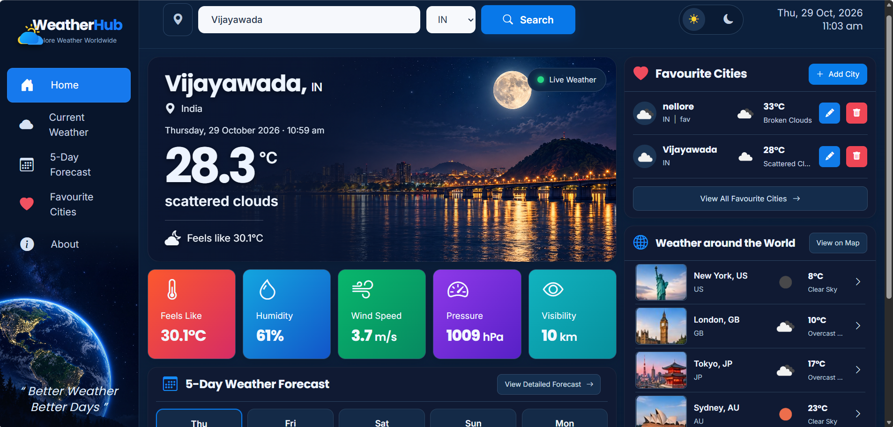
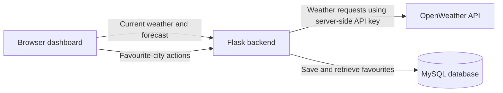
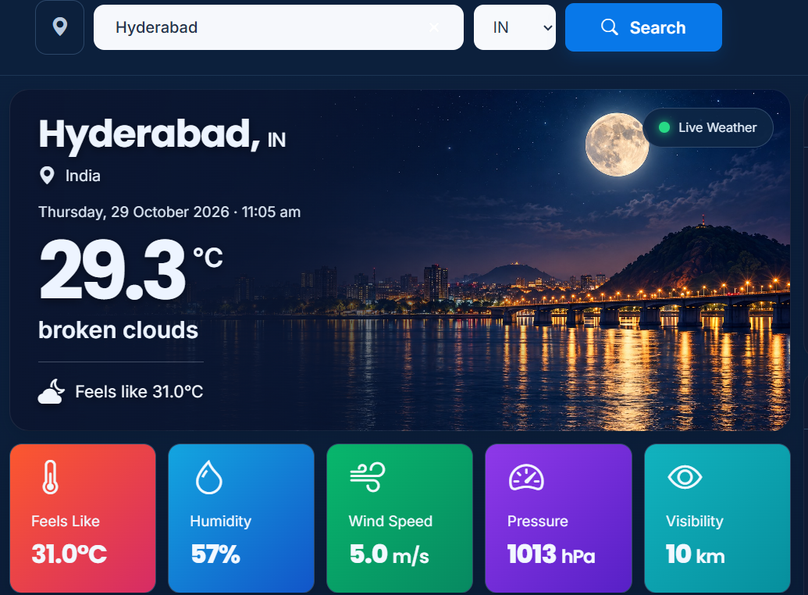
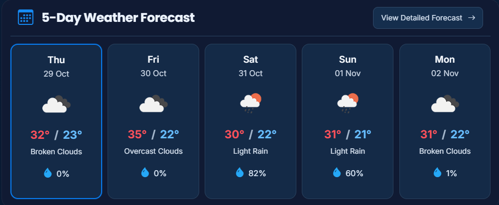
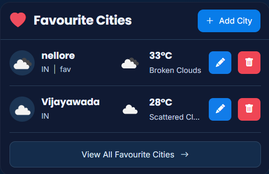

# WeatherHub

WeatherHub is a weather dashboard that helps you check current conditions and a five-day forecast for cities around the world. Search for a location, view details like temperature and humidity, and save favourite cities for quick access.



## Features

- Search for current weather by city and country.
- View a five-day forecast built from OpenWeather forecast data.
- Save, view, edit, and delete favourite cities.
- See weather for selected cities around the world.
- Switch between dark and light themes.
- Use the JSON API endpoints documented below and the ready-to-import Postman collection.

## Architecture



## Project structure

```text
.
├── app.py                       # Flask app, page route, health check, blueprint registration
├── config.py                    # environment-based configuration
├── database.py                  # MySQL connection helper
├── schema.sql                   # database and favourites table
├── routes/
│   ├── weather_current.py       # GET /api/weather/current
│   ├── weather_forecast.py      # GET /api/weather/forecast
│   ├── favorites_create.py      # POST /api/favorites
│   ├── favorites_read.py        # GET /api/favorites and /api/favorites/<id>
│   ├── favorites_update.py      # PUT /api/favorites/<id>
│   └── favorites_delete.py      # DELETE /api/favorites/<id>
├── templates/index.html         # dashboard served at /
├── static/css/style.css
├── static/js/app.js
├── static/img/                  # dashboard and city images
├── postman/WeatherHub.postman_collection.json
├── Screenshots/                 # README screenshots
├── requirements.txt
├── .env.example
└── .gitignore
```

## Requirements

- Python 3.10 or newer
- MySQL 8 or a compatible MySQL server
- An OpenWeather API key with access to Current Weather and 5 Day / 3 Hour Forecast

## Run locally

Run commands from the project directory—the folder containing `app.py`.

1. Create and activate a virtual environment:

   ```powershell
   python -m venv .venv
   .\.venv\Scripts\Activate.ps1
   ```

   On macOS/Linux, activate it with `source .venv/bin/activate`.

2. Install the application dependencies:

   ```powershell
   python -m pip install -r requirements.txt
   ```

3. Create the MySQL database and favourites table from `schema.sql`.

   **Windows PowerShell** (with `mysql.exe` available on `PATH`):

   ```powershell
   Get-Content -Raw .\schema.sql | mysql.exe -u root -p
   ```

   **macOS/Linux or Git Bash:**

   ```bash
   mysql -u root -p < schema.sql
   ```

   Enter your MySQL root password when prompted.

4. Create your local environment file and edit it:

   ```powershell
   Copy-Item .env.example .env
   ```

   Open `.env` in VS Code. Set `OPENWEATHER_API_KEY` to your own key and update the MySQL settings if needed. The sample uses `MYSQL_PORT=3306`. Keep `.env` private; never commit it or put the key in `static/js/app.js`.

5. Start Flask:

   ```powershell
   python app.py
   ```

6. Open <http://localhost:5000>. The health endpoint is <http://localhost:5000/api/health>.

If you change `.env`, stop and restart the Flask server so it reloads the settings.

## API routes

| Method | Route | Purpose |
|---|---|---|
| GET | `/api/health` | Flask health check |
| GET | `/api/weather/current?city=Vijayawada&country=IN` | Current conditions |
| GET | `/api/weather/forecast?city=Vijayawada&country=IN` | Five-day forecast from OpenWeather's three-hour readings |
| POST | `/api/favorites` | Add a favourite (`city`, `country`, optional `nickname`) |
| GET | `/api/favorites` | List favourite cities |
| GET | `/api/favorites/<id>` | Read one favourite |
| PUT | `/api/favorites/<id>` | Update a favourite (`city`, `country`, optional `nickname`) |
| DELETE | `/api/favorites/<id>` | Delete a favourite |

Example favourite JSON:

```json
{"city":"Vijayawada","country":"IN","nickname":"Home"}
```

Responses are JSON with a `success` field and either `data` or an `error`/`message`. Duplicate city/country pairs return HTTP 409; missing records return 404. The database's uniqueness check uses the city and country spelling as entered, so use consistent spelling.

## Check the API with Postman

Import `postman/WeatherHub.postman_collection.json` into Postman. The collection uses `baseUrl` (`http://localhost:5000` ) and `favoriteId` variables. After creating a favourite, set `favoriteId` to the returned `data.id` before sending read-one, update, or delete requests.

The collection includes health, weather, validation, and favourite CRUD requests. Run it against your local server and database: some requests call OpenWeather, and the CRUD requests create or change local database records. It is a manual integration check, not an isolated automated test suite or a CI workflow.

## Notes

- The browser calls the Flask API; it does not need the OpenWeather API key.
- Weather units are metric: temperatures in Celsius, wind in metres/second, and visibility in kilometres.
- The forecast endpoint returns normalized OpenWeather entries; the frontend groups them by day and displays up to five days.
- Keep `FLASK_DEBUG=false` outside local development. Configure a strong `FLASK_SECRET_KEY` for any deployment, and use a production WSGI server rather than Flask's development server.
- `.env.example` contains placeholders only. Keep actual credentials in your private `.env` file and never commit it.

## More screenshots

### City Search


### Forecast View


### Favourite Cities

